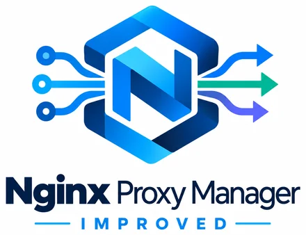

<p align="center">
  
</p>

<h1 align="center">NPM Improved</h1>

<p align="center">
  <strong>Reverse proxy management built for real-world reliability.</strong><br>
  An independently maintained Nginx Proxy Manager fork with built-in high availability, safer configuration changes, encrypted backups, and a dedicated recovery control plane.
</p>

<!-- GIGABYTE GROVE REPOSITORY BADGES START -->
<p align="center">
  <a href="https://github.com/gigabytegrove/npm-improved"></a>
  <a href="https://github.com/gigabytegrove/npm-improved/stargazers"></a>
  <a href="https://github.com/gigabytegrove/npm-improved/forks"></a>
  <a href="https://github.com/gigabytegrove/npm-improved/issues"></a>
  <a href="https://github.com/gigabytegrove/npm-improved/releases"></a>
  <a href="https://github.com/gigabytegrove/npm-improved/blob/develop/LICENSE"></a>
  <a href="https://paypal.me/gigabytegrove"></a>
</p>
<!-- GIGABYTE GROVE REPOSITORY BADGES END -->

<p align="center">
  <a href="#quick-start-with-docker">Install</a> ·
  <a href="#features">Features</a> ·
  <a href="docs/src/guide/index.md">Documentation</a> ·
  <a href="ROADMAP.md">Roadmap</a> ·
  <a href="https://www.gigabytegrove.com/projects">Project page</a>
</p>

> **Install [v1.8.0](https://github.com/gigabytegrove/npm-improved/releases/tag/v1.8.0)** — prebuilt Docker images for Linux AMD64 and ARM64. No source build required.

## Quick start with Docker

NPM Improved runs as Linux containers on Docker. It is not tied to Ubuntu, Debian, or an x86-64 host OS. The v1.8.0 deployment targets **linux/amd64 and linux/arm64**. Use a compatible Docker Engine or Docker Desktop in Linux-container mode, including supported Linux distributions, Windows, macOS, and NAS platforms. Windows-native containers and other CPU architectures are not supported by these images. Host networking, storage permissions, and capability restrictions vary by platform.

### Standard Docker Compose (recommended for portable deployment)

Requires Docker and Docker Compose v2. No systemd, Linux package manager, Git clone, compilation, or local image build is needed.

Create a dedicated project directory and save [compose.yaml](deploy/compose.yaml) into it as `compose.yaml` (use **Raw** or download the file on GitHub). This SQLite template contains only published image references and persistent mounts. From that directory, run these commands in your usual terminal, including PowerShell:

```bash
docker compose pull
docker compose up -d --no-build --pull never --wait --wait-timeout 240
docker compose ps
```

Open `http://localhost:81` on the Docker host, or port 81 on the remote Docker host. For alternate host ports, create a file named `.env` next to the Compose file:

```dotenv
HTTP_PORT=8080
ADMIN_PORT=8181
HTTPS_PORT=8443
```

For example, the management UI then uses port 8181. Use the same project directory for all future operations.

**Security:** Restrict the management port to a trusted network or VPN. The default SQLite template includes the release's firewall companion, which requires Docker support for `NET_ADMIN` in the application network namespace. If your host cannot grant this capability, explicitly deploy only the app with `docker compose pull app` followed by `docker compose up -d --no-build --pull never --wait app`; the companion's instance-level network filtering is then unavailable. Use an appropriate host firewall. This is a reduced-feature deployment, not a way to bypass a host security policy. Docker Desktop and NAS deployments must provide persistent writable storage with Linux-compatible file permissions. For clustered deployments set a unique `NPM_NODE_HOSTNAME` in `.env`.

If a registry pull fails, stop and use the verified release archive recovery path in the Docker guide; never build from source.

### MariaDB / MySQL or PostgreSQL

Use [compose.mysql.yaml](deploy/compose.mysql.yaml) or [compose.postgres.yaml](deploy/compose.postgres.yaml) instead. Set strong unique database passwords in a private `.env` file before pulling and starting the selected stack. See [DOCKER.md](DOCKER.md) for commands and storage details.

### Optional managed installation on Linux hosts with systemd

For native **Settings → Update** support, use the managed host installer on a Linux Docker host running systemd. Install Docker, Compose v2, Bash, curl, Python 3, CA certificates, gzip, and iproute2 using your distribution's package tools. No Ubuntu or Debian requirement applies. The installer uses published images, automatically selects free ports with `--auto-ports`, and installs the native updater. It refuses to overwrite an existing project.

```bash
(
  set -e
  installer="$(mktemp)"
  trap 'rm -f "$installer"' EXIT
  curl -fsSL https://raw.githubusercontent.com/gigabytegrove/npm-improved/develop/scripts/install-release -o "$installer"
  sudo bash "$installer" sqlite --auto-ports
)
```

Use `mysql` or `postgres` for a managed database deployment. This path stores the deployment in `/opt/npm-improved`. The portable Compose path does not provision the native updater.

## Default ports

The normal container-side ports are:

| Port | Used for |
| ---: | --- |
| **80** | HTTP web traffic |
| **81** | NPM Improved Control Center |
| **443** | HTTPS web traffic |

The host-side ports can be changed in `.env` when needed.

## Persistent data

The important persistent locations are:

```text
/data
/etc/letsencrypt
```

Keep both locations on persistent storage.

Even though NPM Improved includes application-level backups, infrastructure-level backups or snapshots of these locations are still recommended.

## Updating

For portable Compose deployments, back up persistent data, review the target release notes, update the pinned application image (and matching firewall image, when used), pull the images, and recreate the same stack with `docker compose up -d --no-build --pull never --wait`. The native systemd updater is not available on this path.

For existing installations with a managed native updater, use **Settings → Update** to download the published image and perform a health-verified replacement with rollback. The host-side updater is a native systemd service, not an updater container. The fresh-install command deliberately refuses to overwrite existing deployments.

For legacy deployments or coordinated Shared MySQL upgrades, see [DOCKER.md](DOCKER.md) and the target release notes. Preserve the existing Compose project, data and certificates.

For every upgrade:

- keep a current backup;
- review release notes;
- verify Proxy Hosts, certificates, streams, logs, health, and database state afterward.

## Features

Everything you expect from Nginx Proxy Manager — proxy and redirection hosts, 404 hosts, TCP/UDP streams, TLS certificates, access lists, WebSockets, custom locations and advanced Nginx configuration — plus tools for running a reliable proxy in production.

| Capability | What NPM Improved adds |
| --- | --- |
| **Control Center** | Redesigned management interface, separate from the Nginx traffic process, with node-local health and recovery access. |
| **Safe configuration changes** | Validates with `nginx -t` before activation; rolls back failed configuration and matching database changes. [Configuration History](docs/src/guide/config-history.md) tracks revisions and restores known-good states. |
| **Backend high availability** | Multiple upstreams per Proxy Host, weighted routing, round robin, least connections, IP affinity and primary/failover. [Guide](docs/src/guide/high-availability.md) |
| **Multi-node synchronization** | NPMX (NPM Improved Exchange) pairs Primary and Secondary nodes with short-lived codes and synchronizes encrypted configuration snapshots, certificates and custom assets. [Guide](docs/src/guide/instance-sync.md) |
| **Flexible database storage** | SQLite, MariaDB/MySQL and PostgreSQL deployment options; verified SQLite ↔ MySQL/MariaDB migration and shared MySQL mode. [Guide](docs/src/guide/database.md) |
| **Backup & recovery** | AES-256-GCM encrypted configuration and full disaster-recovery backups, inspection before restore and validated rollback. [Guide](docs/src/guide/disaster-recovery.md) |
| **Emergency recovery** | Independent recovery console for diagnostics, Nginx validation, reload and backup restoration. [Guide](docs/src/guide/recovery-console.md) |
| **Traffic analytics & health** | Node-local HTTP and stream metrics, response times, bandwidth, status codes, per-host analysis and service health. [Analytics](docs/src/guide/analytics-center.md) · [System Health](docs/src/guide/system-health.md) |
| **Security & certificates** | Managed HTTP rate and connection limits, structured security events, certificate usage tracking and unused-certificate quarantine. [HTTP Protection](docs/src/guide/protection.md) |
| **Cluster-aware Default Sites** | Custom HTML and redirects with node, cluster and system template variables rendered locally on each proxy. |
| **Managed updates** | Native host-side update, restart and rollback on compatible Linux systemd hosts; no permanent updater container. Portable Docker installations use the normal container lifecycle. |

## Operational notes

- **High availability:** Backend pools protect against application-server outages; NPMX synchronization prepares multiple reverse-proxy nodes. DNS, an external load balancer or a virtual IP is still needed to direct traffic between proxy nodes.
- **Shared MySQL:** Nodes must use compatible NPM Improved versions and share or replicate certificate and custom SSL files.
- **Recovery:** The independent recovery console uses a separate credential at `http://<host>:81/recovery/`. The independent health endpoint is `/__npm_improved/health`. Keep management access on a trusted network or VPN.
- **Migration:** NPM Improved is an independent fork with additional database fields and generated configuration. Back up before migrating; do not assume that NPM Improved data can be downgraded safely to upstream Nginx Proxy Manager.
- **Protection:** HTTP protection mitigates application-layer abuse; it does not replace upstream volumetric DDoS protection.

## Documentation

| Getting started | Administration |
| --- | --- |
| [NPM Improved Guide](docs/src/guide/index.md) | [Database & Shared MySQL](docs/src/guide/database.md) |
| [Docker installation and recovery](DOCKER.md) | [Backup & Disaster Recovery](docs/src/guide/disaster-recovery.md) |
| [Backend high availability](docs/src/guide/high-availability.md) | [Recovery Console](docs/src/guide/recovery-console.md) |
| [Instance Synchronization](docs/src/guide/instance-sync.md) | [Configuration History](docs/src/guide/config-history.md) |
| [Proxy Host Analytics](docs/src/guide/proxy-host-analytics.md) | [HTTP Protection](docs/src/guide/protection.md) |

## Development & support

- **Releases:** [Published releases](https://github.com/gigabytegrove/npm-improved/releases) · Official images: `ghcr.io/gigabytegrove/npm-improved`. The upstream `jc21/nginx-proxy-manager` image does not include NPM Improved features.
- **Contributing:** The active integration branch is `develop`. Submit changes through pull requests, satisfy required checks, and update relevant documentation. `scripts/install-docker` and repository-root build templates are for intentional development builds, not normal deployment.
- **Issues:** [Report bugs and request features](https://github.com/gigabytegrove/npm-improved/issues). Report security vulnerabilities privately using the [Security Policy](SECURITY.md).
- **Support the project:** [Donate via PayPal](https://paypal.me/gigabytegrove) — optional and never required.

## License & attribution

NPM Improved is an independently maintained **Gigabyte Grove** project originating from [Nginx Proxy Manager](https://github.com/NginxProxyManager/nginx-proxy-manager). It is not an official upstream release and is not affiliated with or endorsed by the upstream maintainers.

The upstream MIT license and copyright notices are preserved in [LICENSE](LICENSE). NPM Improved uses its own Gigabyte Grove artwork. See [Origins and Credits](CREDITS.md) for attribution and licensing details.
